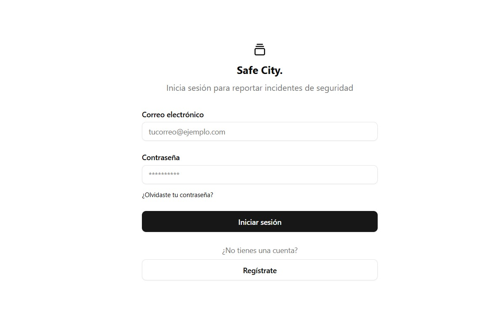
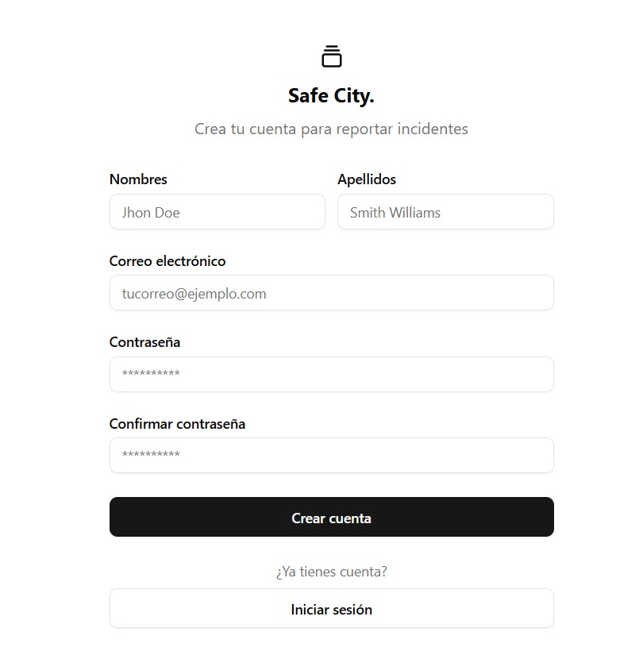
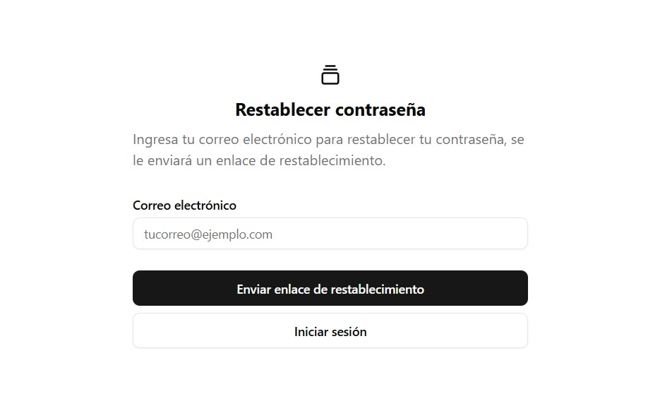
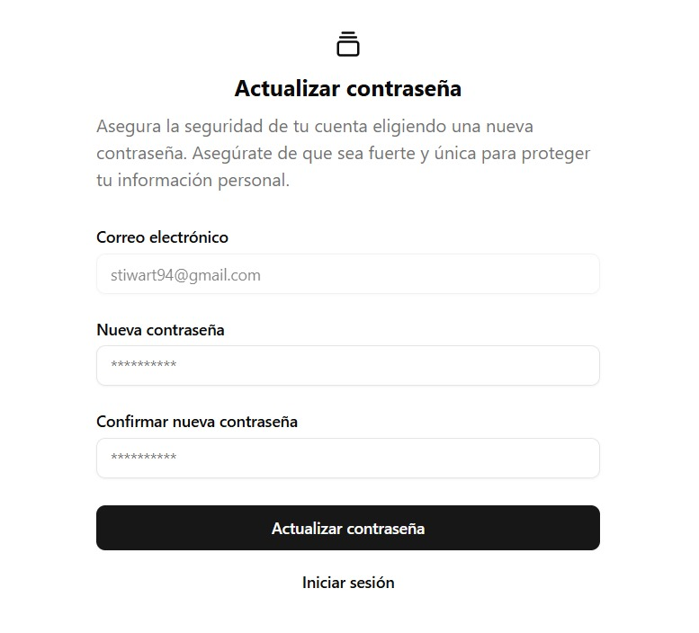
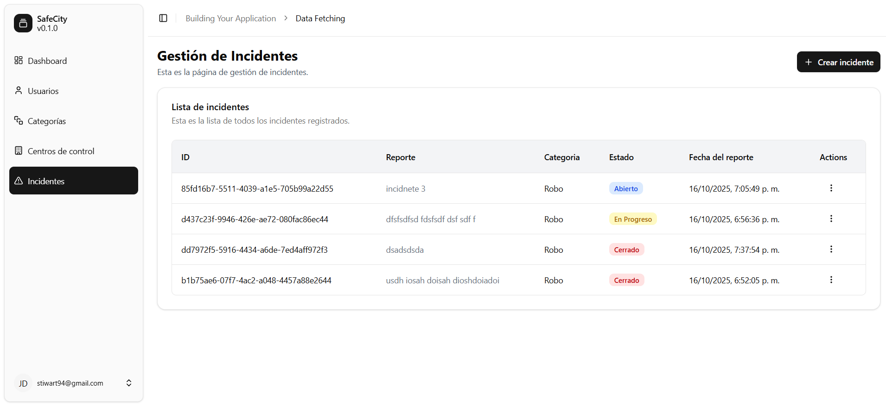
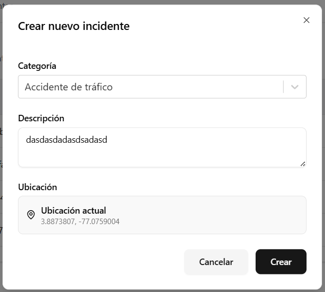
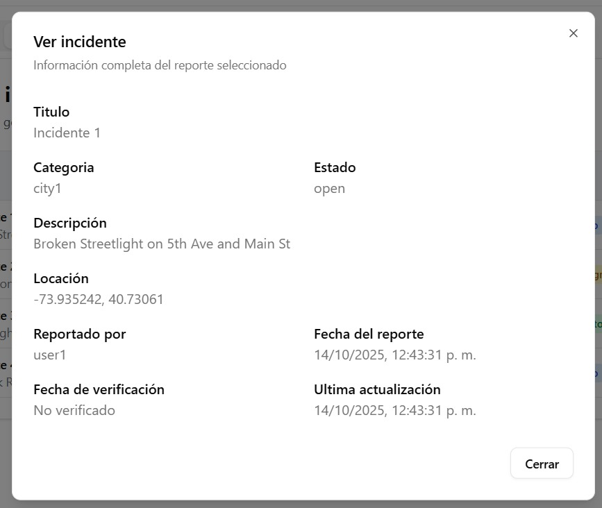

# Prueba técnica – Desarrolladodr Front-End React Junior

## Descripción del proyecto

SafeCity será una plataforma colaborativa de seguridad ciudadana que tiene como objetivo principal facilitar la comunicación entre ciudadanos y autoridades mediante el reporte colaborativo de incidentes de seguridad en tiempo real. Los usuarios pueden reportar eventos como robos, accidentes, zonas peligrosas y situaciones sospechosas, visualizar incidentes en un mapa interactivo, comentar y validar reportes, y recibir notificaciones sobre eventos cercanos a su ubicación. Las autoridades, por su parte, pueden gestionar incidentes, actualizar estados, generar reportes estadísticos y coordinar respuestas efectivas

Actualmente se cuenta con la [API](https://api2.safecity.fun/api/v1/docs#/), se busca desarrollar la infertaz grafica e integrarla con la API.

Existen dos roles **admin** y **user**.

## Objetivo de la prueba

El candidado deberá:

- Crear la vistas e integrar el módulo de autenticación, [link](https://api2.safecity.fun/api/v1/docs#/operations/auth.login)
- Crear el dashboard para el usuario con rol **admin**
  - Crear las vistas para gestionar las categorias [link](https://api2.safecity.fun/api/v1/docs#/operations/incidentCategories.index)
  - Crear vista para listar los incidentes reportados y ver el detalle de cada uno [link](https://api2.safecity.fun/api/v1/docs#/operations/incidents.index)
- dashboard para el usuario con rol de **user**
  - Listar incidentes deportados y ver su detalle
  - Reportar incidente

## Imagenes

### Inicio de sesión

### Registro

### Olvide mi contraseña

### Restablecer contraseña

### Listar incidente

### Crear incidente

### Ver incidente

### Instrucciones de entrega

1. Realiza un fork o clona el repo base de la prueba
2. Implementa la solución en React y organiza el código en componentes reutilizables.
3. Sube el código a un repositorio público en GitHub y comparte el enlace o realiza una pull request al repositorio principal.

### Notas finales

Esta prueba busca evaluar habilidades técnicas clave para un desarrollador React junior, incluyendo el consumo de APIs, manipulación de datos, optimización del código y buenas prácticas. No es obligatorio completar todos los puntos, pero se valorará la calidad del código y la solución presentada.
